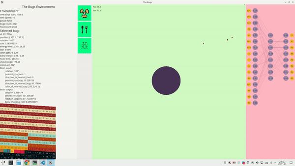

# Bugs

[](https://github.com/burbokop/bugs/actions/workflows/ci.yml)

Bugs is an evolution sumulator



## Run
```bash
cargo run --release
```

### Create environment
```bash
cargo run --release -- new --env-preset circle --renderer sdl
```

### Load environment
```bash
cargo run --release -- load --renderer sdl
```

## Run simulator
```bash
cargo run --release --package bugs-simulator
```

## Profile
```bash
sudo sysctl kernel.perf_event_paranoid=2
CARGO_PROFILE_RELEASE_DEBUG=true cargo flamegraph -b bugs
```

## Fuzz
```bash
rustup default nightly
cargo fuzz run limited_resource_environment
```
